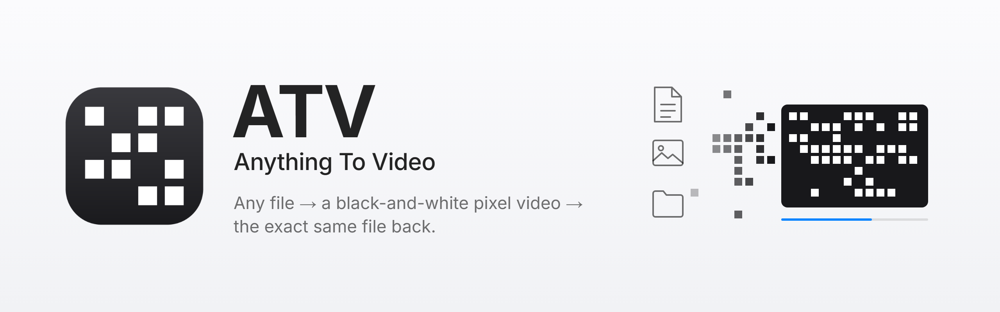
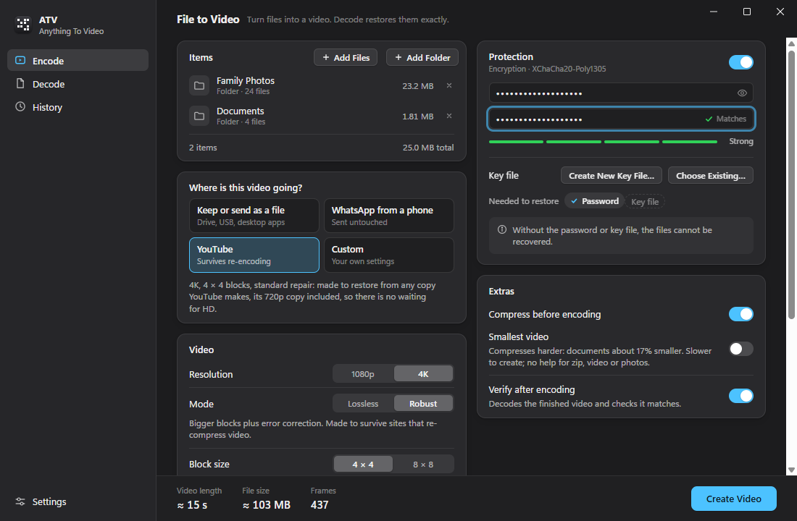
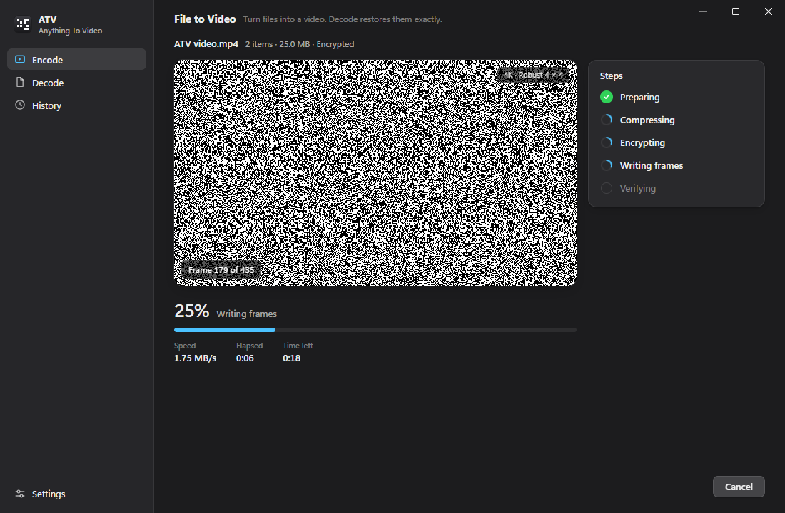
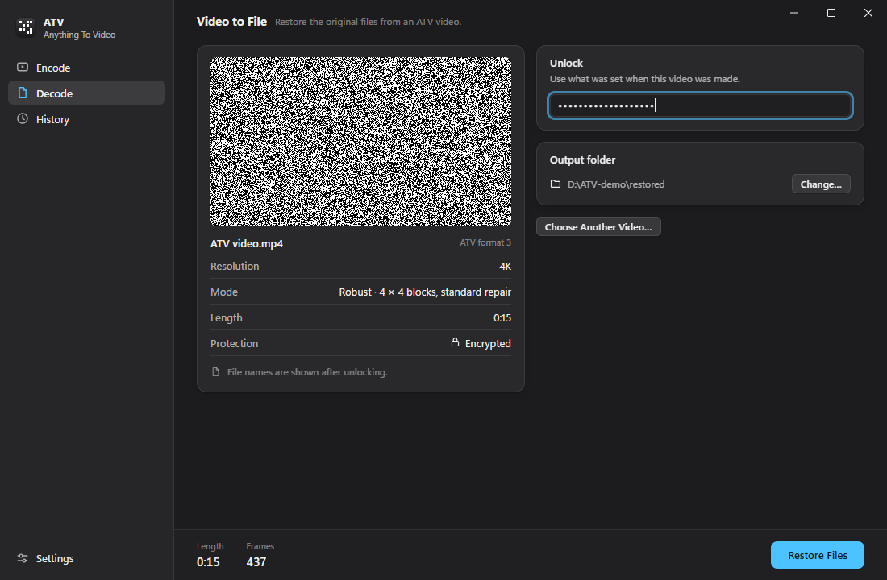
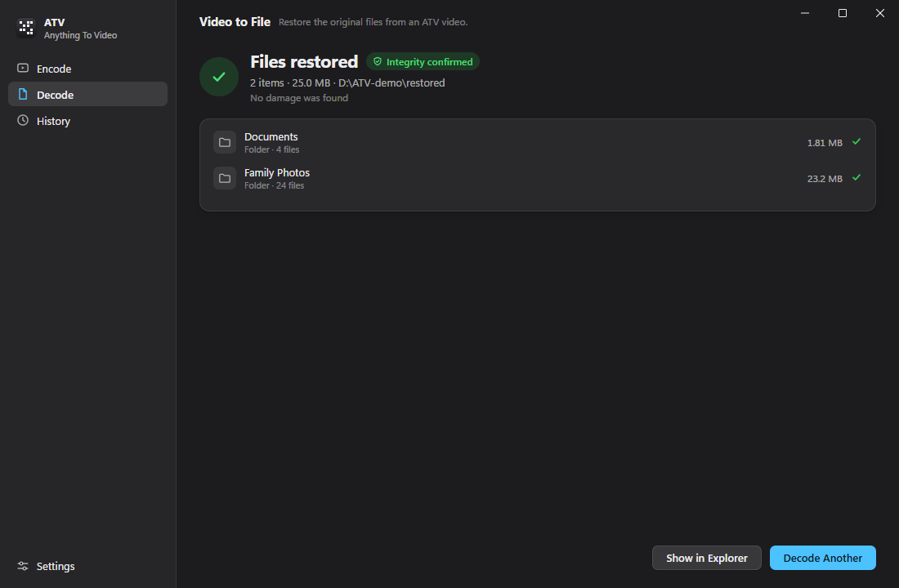
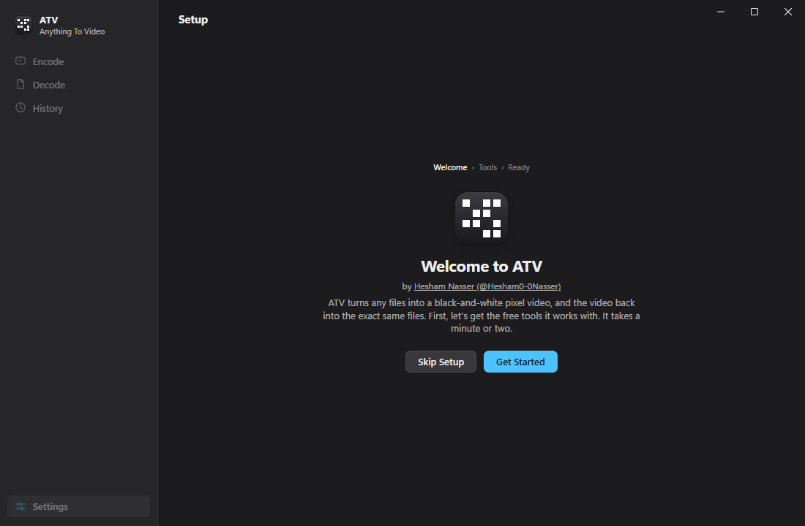

<picture>
  <source media="(prefers-color-scheme: dark)" srcset="assets/atv-header-dark.png">
  
</picture>

<p align="center">Made by <a href="https://github.com/Hesham0-0Nasser">Hesham Nasser (@Hesham0-0Nasser)</a> · GPL-3.0 · Windows and macOS</p>

**ATV** turns any file or folder into a black-and-white pixel video (black = 0, white = 1), and turns that video back into the exact same files. Lock it with a password or a key file, keep it on a drive, or put it on YouTube or WhatsApp and restore the files from the copy the site gives back.

<p align="center">
  
  
</p>
<p align="center">
  
  
</p>

## What it does

- **Any input.** Files, folders, several at once. Names, folders and dates come back as they were.
- **Exact.** Every restore is checked against a SHA-256 of the original data; nothing half-restored is ever left behind.
- **Two modes.**
  - **Lossless:** one pixel per bit (FFV1). The video is about the size of your files, or smaller for documents. For your own drives and cloud storage, sent as a file.
  - **Robust:** blocks of 4 × 4 or 8 × 8 pixels with LDPC error correction (H.264, or AV1 for smaller uploads). Made to survive sites that re-compress video.
- **Where is this video going?** Pick *Keep as a file*, *WhatsApp from a phone* or *YouTube* and ATV chooses the settings that were tested to work there. *Custom* lets you choose everything yourself.
- **Encryption.** XChaCha20-Poly1305 with a key from a password (Argon2id), a key file, or both. An encrypted video looks like random static; without the secret it cannot be turned back into files. Passwords that are easy to guess are refused unless a key file is used too.
- **Compression.** zstd with long-distance matching, so data repeated within 512 MB, such as copies of a file in different folders, is stored once. ATV measures the real size before you start.
- **Restore from YouTube links.** Paste a link on the Decode screen; ATV downloads the best copy and restores it.
- **Live preview, progress and history**, light and dark, the system accent colour.

## Install

### Windows 10 and 11

Download from the Releases page:

- **`ATV_<version>_x64-setup.exe`**: installs for your user only, no admin rights, Start menu entry, uninstaller.
- **`ATV_<version>_x64-portable.zip`**: no install. `AnythingToVideo.exe` is the app; `atv.exe` is the command-line tool.

On first start, a short setup wizard installs the free tools ATV works with, from their official releases, checking each download against the published checksum:

- **ffmpeg** (required): writes and reads the videos.
- **yt-dlp** and a JavaScript runtime such as **Deno** (optional): only for opening videos from YouTube links.

<p align="center"></p>

You can run the wizard again from Settings → Tools, which also keeps the tools up to date.

### macOS

Not yet packaged or tested on a Mac. Build it from source (below), and install the tools with Homebrew:

```
brew install ffmpeg yt-dlp deno
```

## Use it

1. **Encode:** add files or folders, choose where the video is going, set a password or a key file, and press **Create Video**. ATV checks the finished video before it says it is done.
2. **Decode:** drop the video (or paste a YouTube link), give the password or key file, and press **Restore Files**.

**Keep your password or key file safe.** Without it, the files cannot be recovered by anyone, including you.

### Command line

```
atv encode <files or folders> -o video.mkv             # Lossless, asks for a password
atv encode <input> -o video.mp4 --mode robust --cell 8   # Robust
atv decode video.mkv -o restored
atv info video.mkv
atv keygen my.atvkey
```

`atv encode --help` lists every option (`--res 4k`, `--key-file`, `--no-encrypt`, `--smallest`, `--av1`, `--fps`, ...).

## How it works

```
files ─► tar ─► zstd ─► + SHA-256 ─► encrypt in chunks ─► frames ─► [error correction] ─► pixels ─► ffmpeg ─► video
```

Restoring runs the same steps backwards and ends with the SHA-256 check. The first two frames of every video hold a small header (mode, cell size, encryption settings), drawn in large blocks so it can be read even from a damaged or resized copy. File names and sizes are inside the encrypted data, never in the header.

Robust mode spreads every error-correction codeword across a group of 15 frames, so a damaged or even lost frame can be repaired from the others.

The exact video format, the encryption, the error correction and the measurements behind every choice are in the [technical specification](docs/project-spec.md).

## Build from source

Needs [Rust](https://rustup.rs) 1.90 or newer and ffmpeg (for the tests and to run it).

```
cargo run --release -p atv-gui              # the app
cargo run --release -p atv-cli -- --help    # the command-line tool
cargo test --workspace                      # tests (the larger ones need ffmpeg and ffprobe)
```

Release packages need the Tauri CLI (`cargo install tauri-cli --version "^2" --locked`):

```
powershell -ExecutionPolicy Bypass -File scripts\build-windows.ps1   # installer + portable zip in dist\
sh scripts/build-macos.sh                                           # .dmg in dist/ (untested)
```

The code is a Cargo workspace: `crates/atv-core` does all the work and has no GUI dependencies, `crates/atv-cli` is the command-line tool, and `crates/atv-gui` is the desktop app (Tauri 2, plain HTML, CSS and JavaScript in `crates/atv-gui/web`).

## Good to know

- Uploading videos that hold data may go against a site's terms of use. That is your call.
- Robust mode was tested with real uploads to YouTube (every copy it made, 720p to 4K, restored) and WhatsApp on Android. Sites change how they compress video; keep your originals.
- Robust videos are several times larger than the data they carry, and WhatsApp's setting uses a low frame rate, so large folders make long videos.

## Credits

Made by **[Hesham Nasser (@Hesham0-0Nasser)](https://github.com/Hesham0-0Nasser)**.

ATV builds on [ffmpeg](https://ffmpeg.org), [yt-dlp](https://github.com/yt-dlp/yt-dlp), [Deno](https://deno.com), [Tauri](https://tauri.app), [RustCrypto](https://github.com/RustCrypto) (Argon2, XChaCha20-Poly1305), [zstd](https://facebook.github.io/zstd/) and [zxcvbn](https://github.com/shssoichiro/zxcvbn-rs).

## Licence

Copyright (C) 2026 Hesham Nasser.

ATV is free software: you can redistribute it and/or modify it under the terms of the GNU General Public License, version 3, as published by the Free Software Foundation. It is distributed in the hope that it will be useful, but WITHOUT ANY WARRANTY; see [LICENSE](LICENSE) for details.
